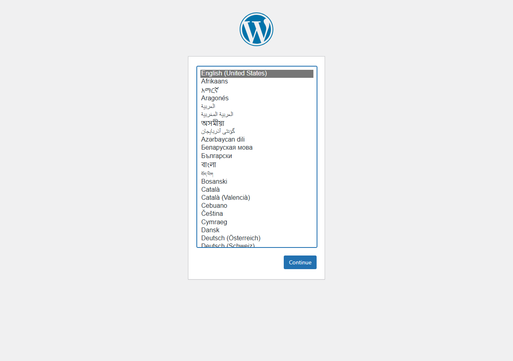
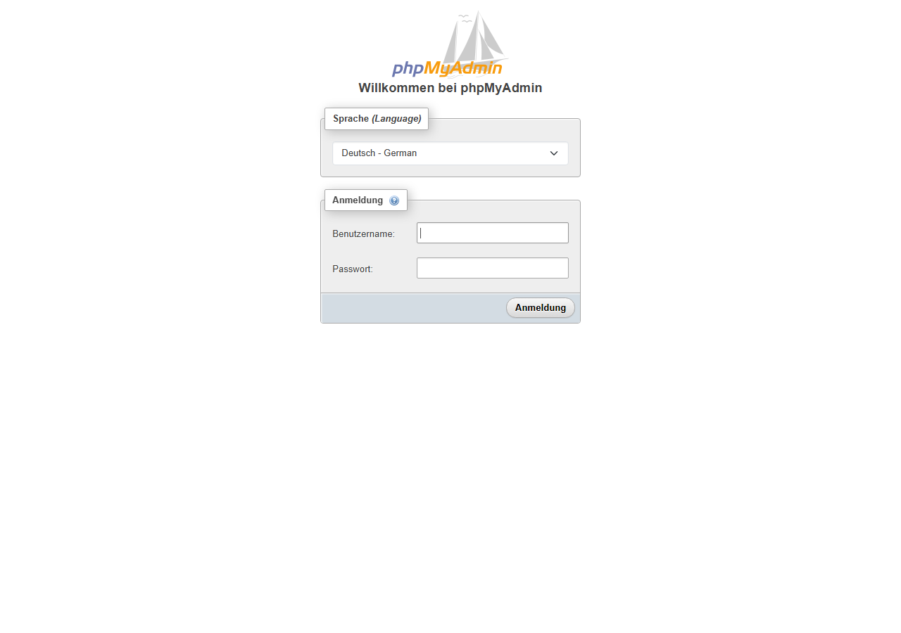

# wp-int-KPA – Lokale WordPress-Entwicklungsumgebung

Lokale Entwicklungs- und Integrationsplattform für das WordPress-Intranet des Kunden.
Entwicklung und Konfiguration finden hier statt – **nicht** mehr am produktiven System.

**Team KPA:** Eren Kesik, Christofer Pütz, Wissam Alsafori

## Kurzanleitung

1. **Docker Desktop** installieren und starten (unten links muss „Engine running“ stehen).
2. **Repository herunterladen:** Terminal öffnen und eingeben:
   ```bash
   git clone https://github.com/BKUerdingen/wp-int-KPA.git
   cd wp-int-KPA
   ```
3. **Zugangsdaten anlegen:** Die Datei `.env.example` kopieren und die Kopie `.env` nennen
   (`copy .env.example .env`). In der `.env` bei `DB_PASSWORD` und `DB_ROOT_PASSWORD` eigene Passwörter eintragen.
4. **Starten:**
   ```bash
   docker compose up -d
   ```
   Beim ersten Mal dauert es etwa 1 Minute, bis alles läuft.
5. **Im Browser öffnen:**
   - WordPress: http://localhost:8080 → Sprache wählen und WordPress einrichten
   - phpMyAdmin: http://localhost:8081 → Anmelden mit `DB_USER` und `DB_PASSWORD` aus der `.env`
6. **Arbeiten:** Eigene Plugins und Themes in `wordpress/wp-content/plugins` bzw. `themes` ablegen – sie sind sofort in WordPress sichtbar.
7. **Beenden:**
   ```bash
   docker compose down
   ```
   Die Daten bleiben erhalten und sind beim nächsten `docker compose up -d` wieder da.

**Probleme?**
- *Port belegt:* In der `.env` `WP_PORT` bzw. `PMA_PORT` ändern (z. B. 8090).
- *„Virtualization support not detected“:* Als Administrator `wsl --install --no-distribution` ausführen und den PC neu starten.
- *Alles zurücksetzen (löscht die Datenbank!):* `docker compose down -v`

## Aufbau

| Service | Image | Aufgabe | Erreichbar unter |
|---|---|---|---|
| `wordpress` | `wordpress:6-php8.3-apache` | WordPress 6 mit PHP 8.3 / Apache | http://localhost:8080 |
| `db` | `mariadb:11.4` | Datenbank (MariaDB LTS) | nur intern (`db:3306`) |
| `phpmyadmin` | `phpmyadmin:5.2` | Datenbank-Verwaltung im Browser | http://localhost:8081 |

- **Abhängigkeiten:** `db` hat einen Healthcheck. `wordpress` und `phpmyadmin` starten erst, wenn `db` „healthy“ ist (`depends_on` mit `condition: service_healthy`).
- **Persistenz:** Die Datenbank liegt im Named Volume `db_data` und bleibt auch nach `docker compose down` erhalten.
- **Sync Host ↔ Container:** `./wordpress/wp-content` ist per Bind-Mount nach `/var/www/html/wp-content` eingebunden. Eigene Plugins und Themes werden lokal bearbeitet und sind sofort im Container aktiv.
- **Netzwerk:** Compose-Standardnetzwerk. Die Datenbank hat keinen Port nach außen.
- **Sicherheit:** Zugangsdaten stehen nur in der lokalen `.env`, die per `.gitignore` nicht ins Repository kommt.

## Projektstruktur

```
wp-int-KPA/
├─ docker-compose.yml
├─ .env.example
├─ README.md
├─ KI_PROMPTS.md
├─ wordpress/
│  └─ wp-content/
│     ├─ plugins/   (eigene Plugins)
│     ├─ themes/    (Child-Theme optional)
│     └─ uploads/   (Medien, nicht versioniert)
├─ docs/screenshots/
└─ .gitignore
```

## Inbetriebnahme

Voraussetzung: Docker Desktop (mit WSL 2) läuft.

```bash
git clone https://github.com/BKUerdingen/wp-int-KPA.git
cd wp-int-KPA
cp .env.example .env        # Windows: copy .env.example .env
# .env öffnen und eigene Passwörter eintragen
docker compose up -d
docker compose ps           # db muss "healthy" sein
```

- WordPress-Installer: http://localhost:8080
- phpMyAdmin: http://localhost:8081 – Anmeldung mit `DB_USER` / `DB_PASSWORD` aus der `.env`

Stoppen: `docker compose down` (Daten bleiben erhalten).
Alles zurücksetzen inklusive Datenbank: `docker compose down -v`.

## Test

Getestet am 14.10.2026 mit Docker Engine 29.8.0:

- `docker compose ps`: `db` ist *healthy*, danach starten `wordpress` und `phpmyadmin`
- http://localhost:8080 leitet auf `/wp-admin/install.php` weiter (WordPress-Installer)
- http://localhost:8081 zeigt die phpMyAdmin-Anmeldung, die Anmeldung mit dem DB-User `wp_user` funktioniert
- Bind-Mount: Die WordPress-Standarddateien erscheinen auf dem Host unter `wordpress/wp-content/`

### WordPress-Installer (Port 8080)



### phpMyAdmin (Port 8081)



## Git-Workflow

1. Änderungen auf einem Feature-Branch (`feature/...`)
2. Pull Request gegen `main`
3. Review durch ein Teammitglied (`main` ist geschützt, mindestens 1 Review nötig)
4. Nach Freigabe Merge in `main`, optional Tag (z. B. `v0.1.0`)
